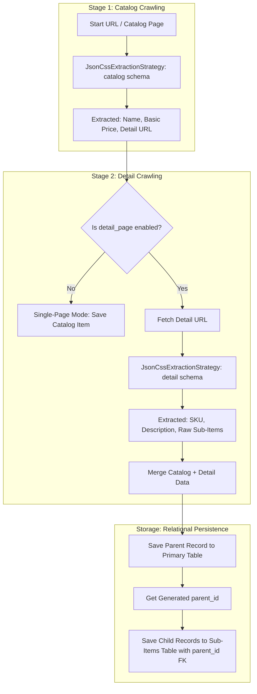

# Konsep dan Arsitektur Web Scraping: Two-Stage Crawling, Relasi Parent-Child, dan Config-Driven Schema

Dokumen ini menjelaskan konsep arsitektur, pola desain, serta panduan praktis implementasi web scraper modular berbasis Python dan Crawl4AI. Pendekatan yang digunakan adalah **Config-Driven Architecture**, di mana kode Python berfungsi murni sebagai mesin eksekusi (*engine*), sedangkan logika ekstraksi website sepenuhnya dikendalikan oleh konfigurasi YAML dan skema JSON.

---

## 1. Filosofi Config-Driven Scraper

Pada implementasi scraper konvensional, setiap kali website target berganti struktur atau ada website baru yang ingin diambil datanya, pengembang harus menulis ulang kode Python (selector CSS, parser, pemanggilan database). Hal ini menyebabkan kode menjadi kaku, sulit dirawat, dan rentan terhadap regresi (*breaking changes*).

Arsitektur **Config-Driven** memisahkan secara tegas antara:
1. **Engine Layer (`src/`)**: Menangani proses perayapan web (*crawling*), eksekusi parser, pembatasan laju request (*rate limiting*), dan persistensi data ke database. Lapisan ini tidak mengenal nama domain tertentu maupun nama kolom spesifik.
2. **Configuration Layer (`targets/`)**: Mendefinisikan URL awal, mode ekstraksi, dan batasan eksekusi per website target.
3. **Schema Layer (`schemas/`)**: Mendefinisikan pemetaan struktur HTML ke atribut data terstruktur (CSS selectors, tipe data, nama field).

Dengan pemisahan ini, penambahan target baru dilakukan hanya dengan menambah file konfigurasi di folder `targets/` dan file skema di folder `schemas/`, tanpa menyentuh kode program di folder `src/`.

---

## 2. Pola Two-Stage Crawling

Sebagian besar situs web modern (seperti e-commerce, portal berita, dan situs direktori) membagi informasinya menjadi dua level:
1. **Level Katalog (Listing Page)**: Menampilkan ringkasan produk atau artikel dalam bentuk kartu, disertai tautan menuju halaman detail.
2. **Level Detail (Detail Page)**: Menampilkan informasi mendalam yang tidak tersedia di halaman katalog (misalnya: deskripsi lengkap, spesifikasi teknis, stok riil, serta pilihan variasi/sub-items).



Pola ini berjalan secara asinkron (*asynchronous*) dengan pembatasan konkurensi (*semaphore*) dan jeda antar-request (*polite rate limiting*) guna mencegah pemblokiran dari server tujuan.

---

## 3. Konsep Relasi Data: Induk (Parent) dan Anak (Child / Sub-Items)

Dalam pemodelan data relasional pada web scraping, data diklasifikasikan menjadi dua peran:

### Data Induk (Parent Record)
Informasi yang bersifat **tunggal (1:1)** pada setiap halaman detail produk atau entitas:
- Contoh E-commerce: Nama Produk (*Abominable Hoodie*), SKU Induk (*MH09*), Deskripsi Produk.
- Contoh Restoran: Nama Restoran, Alamat, Rating, Jam Buka.
- Contoh Hotel: Nama Hotel, Lokasi, Bintang, Fasilitas Umum.

### Data Anak (Child Records / Sub-Items)
Informasi yang bersifat **jamak (1:N / One-to-Many)** di dalam satu entitas induk:
- Contoh E-commerce: Pilihan variasi ukuran (*Size XS, S, M, L, XL*), variasi warna (*Blue, Green, Red*), SKU varian, dan harga masing-masing varian.
- Contoh Restoran: Daftar menu makanan dan minuman (Nama Menu, Kategori, Harga, Kalori).
- Contoh Hotel: Daftar tipe kamar (Standard, Deluxe, Executive Suite, Harga per Malam).

> [!NOTE]
> Hubungan antara data induk dan data anak dihubungkan melalui **Foreign Key** (`parent_id`) yang merujuk pada *primary key* (`id`) dari tabel data induk.

---

## 4. Studi Kasus: E-Commerce WooCommerce

Sebagai implementasi konkret, sistem ini diuji menggunakan website e-commerce berbasis WooCommerce: `https://www.scrapingcourse.com/ecommerce/`.

### Struktur HTML Sumber

1. **Halaman Katalog (`/ecommerce/`)**:
   Setiap kartu produk berada di dalam tag list:
   ```html
   <li class="product">
       <a href="https://www.scrapingcourse.com/ecommerce/product/abominable-hoodie/" class="woocommerce-LoopProduct-link">
           <h2 class="woocommerce-loop-product__title">Abominable Hoodie</h2>
           <span class="price"><span class="woocommerce-Price-amount">$69.00</span></span>
       </a>
   </li>
   ```

2. **Halaman Detail Produk (`/ecommerce/product/abominable-hoodie/`)**:
   Halaman produk memuat judul, SKU, dan deskripsi. Khusus untuk produk dengan variasi, WooCommerce menyertakan data variasi lengkap di dalam atribut form HTML:
   ```html
   <div class="product">
       <h1 class="product_title">Abominable Hoodie</h1>
       <span class="sku">MH09</span>
       <div class="woocommerce-product-details__short-description">...</div>
       <form class="variations_form" data-product_variations='[
           {"variation_id": 247, "sku": "MH09-L-Blue", "attributes": {"attribute_size": "L", "attribute_color": "Blue"}, "display_price": 69, "is_in_stock": true},
           {"variation_id": 248, "sku": "MH09-L-Green", "attributes": {"attribute_size": "L", "attribute_color": "Green"}, "display_price": 69, "is_in_stock": true}
       ]'>
       </form>
   </div>
   ```

---

### Perancangan Skema JSON

#### 1. Skema Katalog: `schemas/ecommerce_catalog.json`
Menugaskan Crawl4AI untuk mengekstrak data ringkasan kartu produk dan URL detail pada halaman listing:

```json
{
  "name": "ecommerce_catalog",
  "baseSelector": "li.product",
  "fields": [
    {
      "name": "name",
      "selector": "h2.woocommerce-loop-product__title",
      "type": "text"
    },
    {
      "name": "price",
      "selector": "span.price",
      "type": "text"
    },
    {
      "name": "detail_url",
      "selector": "a.woocommerce-LoopProduct-link",
      "type": "attribute",
      "attribute": "href"
    }
  ]
}
```

#### 2. Skema Detail: `schemas/ecommerce_detail.json`
Menugaskan Crawl4AI untuk mengekstrak data spesifik halaman detail dan menangkap string JSON variasi dari atribut form:

```json
{
  "name": "ecommerce_detail",
  "baseSelector": "div.product",
  "fields": [
    {
      "name": "name",
      "selector": "h1.product_title",
      "type": "text"
    },
    {
      "name": "sku",
      "selector": "span.sku",
      "type": "text"
    },
    {
      "name": "description",
      "selector": "div.woocommerce-product-details__short-description",
      "type": "text"
    },
    {
      "name": "price",
      "selector": "p.price",
      "type": "text"
    },
    {
      "name": "stock",
      "selector": "p.stock",
      "type": "text"
    },
    {
      "name": "raw_variations",
      "selector": "form.variations_form",
      "type": "attribute",
      "attribute": "data-product_variations"
    }
  ]
}
```

---

### Konfigurasi Target YAML: `targets/ecommerce.yaml`

File target mengikat skema katalog, skema detail, serta aturan ekstraksi sub-items:

```yaml
name: ecommerce
start_urls:
  - "https://www.scrapingcourse.com/ecommerce/"
mode: css
schema_file: schemas/ecommerce_catalog.json
rate_limit_seconds: 1.5
max_pages: 1

detail_page:
  enabled: true
  link_field: "detail_url"
  schema_file: schemas/ecommerce_detail.json
  max_details: 3
  concurrency: 2
  sub_items:
    field_name: "raw_variations"
    table_name: "product_variants"
    foreign_key: "product_id"
```

Penjelasan parameter `detail_page`:
- `enabled`: Mengaktifkan alur penelusuran halaman detail.
- `link_field`: Nama atribut dari skema katalog yang menampung link URL detail.
- `schema_file`: Path skema yang digunakan untuk mengekstrak halaman detail.
- `max_details`: Pembatasan jumlah halaman detail yang dikunjungi per sesi (berguna untuk penghematan resource dan pengujian cepat).
- `concurrency`: Jumlah batas request paralel yang diizinkan secara bersamaan.
- `sub_items.field_name`: Menginstruksikan parser untuk mengambil data array dari field tertentu pada hasil ekstraksi detail.
- `sub_items.table_name`: Nama tabel anak pada database SQLite tempat data sub-items disimpan.
- `sub_items.foreign_key`: Nama kolom relasi anak yang merujuk pada ID data induk.

---

## 5. Generic Sub-Items Engine (Anti-Hardcoding)

Masalah umum pada scraper yang tidak dirancang modular adalah ketergantungan logika kode pada domain tertentu (misalnya, membuat variabel `size` dan `color` langsung di dalam kode Python). Hal ini membuat scraper tidak bisa digunakan untuk website selain toko pakaian.

Pada modul `src/extract_subitems.py`, pendekatan yang digunakan adalah **Universal Object Normalizer**:
1. Parser menerima array objek JSON atau list dictionary.
2. Parser tidak membatasi atribut apa yang boleh ada. Jika objek memiliki atribut `ram`, `storage`, `processor`, atau `menu_name`, parser membongkar dan menormalkan atribut tersebut secara dinamis.
3. Parser menghapus prefix bawaan framework website (misalnya mengubah `attribute_size` atau `attribute_pa_color` menjadi `size` dan `color`).
4. Nilai-nilai HTML dibersihkan menjadi teks murni, dan nilai mata uang dinormalkan menjadi angka desimal (*float*).

Tabel berikut menunjukkan bagaimana arsitektur yang sama beradaptasi pada berbagai studi kasus:

| Kasus Penggunaan | Tabel Induk (Parent) | Kolom Induk | Tabel Anak (Sub-Items) | Kolom Anak (Dihasilkan Dinamis) |
| :--- | :--- | :--- | :--- | :--- |
| **Toko Pakaian (Hoodie)** | `products` | `id, name, sku, price` | `product_variants` | `product_id, size, color, price, stock_status` |
| **Toko Komputer (Laptop)** | `products` | `id, name, brand, price` | `laptop_specs` | `laptop_id, ram, storage, processor, price` |
| **Portal Restoran** | `restaurants` | `id, name, address, rating` | `menu_items` | `restaurant_id, menu_name, category, price` |
| **Portal Lowongan Kerja** | `jobs` | `id, title, company, location` | `job_responsibilities` | `job_id, task_description, priority` |

---

## 6. Penyimpanan Relasional dan Idempotensi pada Database

Penyimpanan data pada lapisan `src/storage.py` menjamin integritas relasional dan prinsip **Idempotency**.

### Skema Relasional One-to-Many

```sql
-- Tabel Induk Produk
CREATE TABLE IF NOT EXISTS products (
    id INTEGER PRIMARY KEY AUTOINCREMENT,
    target TEXT NOT NULL,
    source_url TEXT NOT NULL,
    name TEXT NOT NULL,
    price REAL NOT NULL,
    stock TEXT NOT NULL,
    sku TEXT,
    description TEXT,
    scraped_at TEXT NOT NULL,
    UNIQUE(target, source_url, name)
);

-- Tabel Anak Sub-Items / Varian
CREATE TABLE IF NOT EXISTS product_variants (
    id INTEGER PRIMARY KEY AUTOINCREMENT,
    product_id INTEGER NOT NULL,
    scraped_at TEXT NOT NULL,
    variation_id TEXT,
    sku TEXT,
    size TEXT,
    color TEXT,
    price REAL,
    stock_status TEXT,
    FOREIGN KEY(product_id) REFERENCES products(id) ON DELETE CASCADE
);

CREATE INDEX IF NOT EXISTS idx_variant_product_id ON product_variants(product_id);
```

### Prinsip Idempotensi (Anti-Duplikasi Data)

Ketika scraper dijalankan berulang kali pada target yang sama:
1. **Pemeriksaan Keberadaan Record**: Sebelum melakukan penyimpanan, scraper mencocokkan record berdasarkan kunci unik dan kolom identitas.
2. **Kondisi Data Sama**: Jika data yang diambil identik dengan data di database, sistem mencatat status `unchanged` dan hanya memperbarui timestamp `scraped_at` tanpa menduplikasi baris.
3. **Kondisi Data Berubah**: Jika terjadi perubahan harga atau ketersediaan stok, sistem melakukan `UPDATE` pada data terkait dan mencatat histori perubahannya.

---

## 7. Panduan Menambah Target Baru

Untuk menambahkan website target baru ke dalam sistem:

1. Buat skema listing di `schemas/<nama_target>_catalog.json` untuk menangkap kartu item dan `detail_url`.
2. Buat skema detail di `schemas/<nama_target>_detail.json` untuk menangkap atribut lengkap di halaman detail.
3. Buat file konfigurasi di `targets/<nama_target>.yaml` yang menghubungkan kedua skema tersebut.
4. Jalankan perintah eksekusi:
   ```bash
   python -m src.runner --target <nama_target> --db data/<nama_target>.db
   ```
5. Periksa hasil data induk dan data anak melalui terminal:
   ```bash
   python -c "import sqlite3, json; conn = sqlite3.connect('data/<nama_target>.db'); conn.row_factory = sqlite3.Row; print(json.dumps([dict(r) for r in conn.execute('SELECT * FROM <nama_target> LIMIT 5')], indent=2))"
   ```
